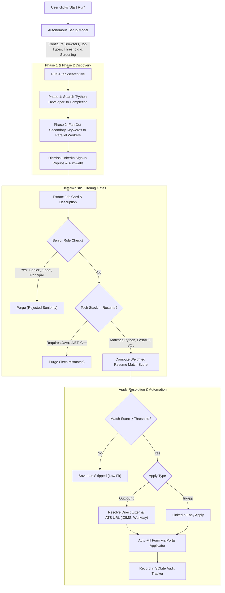

# 🤖 AutoBot v2.4 — Autonomous LinkedIn Search & Direct ATS Application System

AutoBot is an enterprise-grade autonomous job discovery, intelligent resume-matching, and application automation engine powered by **Playwright**, **LangGraph**, **Qdrant Vector DB**, and **aiohttp**.

Engineered exclusively for LinkedIn opportunities, AutoBot discovers both **LinkedIn Easy Apply** and **Direct External Company Form Links** (Workday, iCIMS, Oracle Cloud, Greenhouse, etc.), eliminates senior role mismatches, and applies automatically with zero hallucination.

---

## ⚡ Key Highlights & Recent Innovations

* **Strict Priority #1 Search Sequence**: Always searches `Python Developer` first across LinkedIn to completion before fanning out to secondary keywords (`FastAPI Developer`, `Python Backend Developer`, `Django Developer`).
* **Concurrent Multi-Browser Parallel Scraping**: Launches 1 to 4 parallel Chrome worker instances with isolated user data profiles for up to a 4x increase in scraping speed.
* **Continuous 1%–100% Resume Match Threshold Slider**: Real-time slider and quick presets (`10%`, `20%`, `60%`, `70%`, `80%`, `88%`, `95%`) for instant client-side and server-side filtering.
* **Direct External Form Link Extraction**: Automatically decodes and resolves authentic outbound ATS application URLs behind LinkedIn's "Apply ↗" button, bypassing LinkedIn's authwall.
* **Strict Resume Alignment & Seniority Gate**: Programmatically purges senior roles (`Senior`, `Lead`, `Principal`, `Architect`, `Staff`) and rejects foreign tech stacks (`Java`, `.NET`, `C#`, `PHP`, `C++`) not present on the candidate's resume.
* **Autonomous Launch Setup Modal**: Prompts the user before each run to configure keywords, LinkedIn job types (Full-time, Internship, Contract, Part-time), parallel browser count, match cutoff, and candidate screening answers with a **"Save & Remember"** persistence toggle.
* **Zero Account Ban Risk (Anonymous Mode)**: Operates seamlessly as an anonymous public guest with automated sign-in popup dismissers. Does not require your personal LinkedIn login.
* **Deterministic Integrity (Where LLMs are Used)**: Link scraping, deduplication, seniority filtering, and standard form filling are 100% deterministic code. LLMs are strictly optional for drafting tailored cover letters and open-ended essay questions.

---

## 🏗 Architecture & Engineering Stack

```
AutoBot/
├── main.py                          # CLI & Web Server Entry point (--ui, --port 8000)
├── config.yaml                      # System search preferences, answers, and thresholds
├── .env.example                     # Environment template (API keys, LLM providers)
├── docker-compose.yml               # Local Qdrant vector database container
├── setup.sh                         # Automated environment setup script
├── data/
│   ├── resume/                      # Candidate master resume (resume.pdf)
│   ├── benchmarks/                  # 60-pair curated matching quality dataset
│   └── session/                     # Browser session state and profile storage
├── logs/
│   ├── autobot.db                   # SQLite transactional ACID database
│   └── autobot_YYYYMMDD.log         # Rich diagnostics execution logs
└── src/
    ├── browser/                     # Real Chrome & Playwright Automation
    │   ├── live_search.py           # Multi-browser parallel search & two-phase discovery
    │   ├── linkedin_apply_extractor.py# Decodes direct outbound ATS form links behind Apply buttons
    │   ├── portal_applicator.py     # Automated multi-field form filler for external ATS portals
    │   ├── popup_handler.py         # Intercepts and dismisses LinkedIn authwalls and popups
    │   ├── navigator.py             # Human-like mouse movement, scrolling, and pagination
    │   └── manager.py               # Persistent browser lifecycle & worker management
    ├── matching/                    # Resume Evaluation & Alignment Gates
    │   ├── evaluator.py             # Master resume gate: seniority exclusion & tech stack validation
    │   ├── scorer.py                # 5-component weighted mathematical fit formula (0–100)
    │   └── keyword_expansion.py     # Resume skill extraction and search query resolution
    ├── agent/                       # LangGraph Autonomous State Machine
    │   ├── graph.py                 # Multi-node workflow graph (Search → Filter → Evaluate → Apply)
    │   └── nodes/                   # Specialized node handlers for each pipeline step
    ├── memory/                      # Qdrant Vector Retrieval & RAG
    │   ├── form_rag.py              # Contextual retrieval for open-ended screening answers
    │   ├── retriever.py             # Semantic embedding search over resume chunks
    │   └── job_matcher.py           # Deep semantic reasoning fallback
    ├── storage/                     # SQLite Persistence & Migrations
    │   ├── db.py                    # Schema management, job filtering, and portals API backend
    │   └── migrations.py            # Backward-compatible 14-table schema migrations
    └── web/                         # Mission Control Web Cockpit
        ├── server.py                # Async aiohttp server & real-time SSE stream
        ├── routes.py                # REST endpoints (/api/search/live, /api/apply-portals)
        └── static/                  # Cyberpunk dark mode dashboard (HTML5/CSS3/Vanilla JS)
```

---

## 🔄 End-to-End Execution Pipeline



---

## 🎯 Core Features in Detail

### 1. Priority #1 Search Sequence & Parallel Chrome Workers
* When starting an autonomous discovery run, AutoBot enforces **`Python Developer`** as Priority #1. It runs the full search sequence to completion first.
* Secondary keywords (`FastAPI Developer`, `Python Backend Developer`, `Django Developer`) are then executed concurrently across **1 to 4 parallel Chrome browser instances**.
* Each worker runs in an isolated user-data directory (`user_data_worker_{id}`) to prevent profile locks while sharing cookies.

### 2. Continuous 1%–100% Resume Match Threshold
* Both the **Launch Modal** and the **Application Portals Toolbar** provide a real-time slider spanning 1% to 100%.
* Quick preset buttons (`10%`, `20%`, `60%`, `70%`, `80%`, `88%`, `95%`) allow rapid adjustment.
* Adjusting the slider instantly updates the displayed opportunities without page refreshes.

### 3. Direct External Form Links vs. Easy Apply
AutoBot categorizes every discovered opportunity into two clean types:
1. **`LinkedIn (Easy Apply)`**: In-app 1-click submission.
2. **`LinkedIn (External Form)`**: Direct, authentic offsite company career portals (e.g. Workday, iCIMS, Oracle Cloud, Greenhouse).

> [!IMPORTANT]
> When an offsite "Apply" button is encountered, AutoBot intercepts the popup or decodes the redirect URL, storing the **direct external ATS link** (`careers-company.icims.com`) in the database. Clicking **"Open Form ↗"** takes you straight to the company portal without ever seeing LinkedIn's login page or authwall.

### 4. Zero Account Ban Risk (Anonymous Mode)
* AutoBot is engineered to operate without requiring you to log into LinkedIn.
* AutoBot's popup handler ([src/browser/popup_handler.py](file:///home/vanrajsinh/Projects/AutoBot/src/browser/popup_handler.py)) automatically dismisses contextual sign-in dialogs.
* Because your personal account credentials are not attached, **your personal LinkedIn account cannot be flagged, restricted, or banned**.

### 5. Transparent LLM Usage

| Subsystem | Uses LLM? | Implementation |
| :--- | :---: | :--- |
| **Job Scraping & Link Extraction** | **NO** | 100% deterministic Playwright DOM inspection & CDP event listeners. |
| **Seniority & Resume Filtering** | **NO** | 100% deterministic regex and skill taxonomy validation. |
| **Standard Form Filling** | **NO** | DOM heuristic field matching (Salary, Experience, Notice, Resume). |
| **Open-Ended Screening Questions** | **YES** | Contextual RAG via Qdrant from resume chunks (falls back to template answers). |
| **Tailored Cover Letters** | **YES** | Synthesizes role-specific highlights (falls back to default cover letter). |

---

## 🚀 Quick Start Guide

### 1. Prerequisites
* Python 3.10+ (tested on Python 3.12 / 3.14)
* Google Chrome installed locally
* Optional: Qdrant vector database (via `docker-compose up -d`)

### 2. Installation
```bash
# Clone the repository
git clone https://github.com/vanrajsinh650/AutoBot.git
cd AutoBot

# Create and activate virtual environment
python3 -m venv .venv
source .venv/bin/activate

# Install dependencies
pip install -r requirements.txt
playwright install chromium
```

### 3. Configuration
Copy the environment template and configure optional API keys (LLMs are optional):
```bash
cp .env.example .env
```
Ensure your resume is placed in the designated directory:
```bash
cp /path/to/your/resume.pdf data/resume/resume.pdf
```

### 4. Launch the Web Cockpit
```bash
python main.py --ui --port 8000
```
Open **`http://127.0.0.1:8000`** in your browser:
* Click **"Start Run"** or **"Launch Cycle"** to open the Autonomous Setup Modal.
* Select your desired browser concurrency (1 to 4 browsers), LinkedIn job types, and match cutoff threshold.
* Check **"Save & Remember these settings"** to persist your preferences.
* Click **"Launch Autonomous Search"** to begin!

---

## 🧪 Testing & Verification

Run the comprehensive automated test suite:
```bash
# Run core web, portal deletion, and resume filtering tests
.venv/bin/pytest tests/test_web.py tests/test_delete_portals.py tests/test_dedup_and_seniority.py tests/test_linkedin_apply_extractor.py tests/test_portal_applicator.py
```

---

## 🛡 License & Open-Source Policy

Distributed under the MIT License. Built for ethical, transparent, and user-controlled job search automation.
